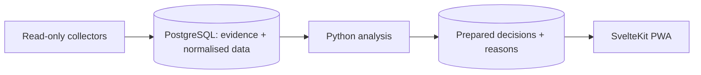

# LFM · explainable fantasy football analytics

[](https://github.com/Braisdlim/lfm-fantasy/actions/workflows/ci.yml)

[Español](README.es.md) · [Code & tests](docs/review.md) · [Architecture](docs/architecture.md) · [Screenshots](docs/walkthrough.md)

**A personal full-stack project for deciding who to buy, what to bid and which eleven to field in LaLiga Fantasy.**

Python collects and analyses changing football data; PostgreSQL stores evidence and prepared results; a SvelteKit PWA presents recommendations with numerical reasons, cash constraints and uncertainty.

**Python · PostgreSQL · SvelteKit · TypeScript · Docker · GitHub Actions**

## Three engineering problems

| Problem | Approach | Evidence |
| --- | --- | --- |
| Repeated historical reads exhausted the database transfer budget | Batched SQL and caches verified against source changes | [Incident case study](docs/engineering.md); [PostgreSQL regression](tests/test_journal_batch.py) checks equal output and six reads for both 4 and 200 holdings |
| A useful lineup must respect availability and game rules | Compare seven legal formations for the next unlocked gameweek; preserve missing-data uncertainty | [Selection code](src/lfm/analysis/eleven.py), [formation tests](tests/test_eleven.py) and [gameweek-horizon regression](tests/test_fixtures_points.py) |
| A failed calculation must not discard collected evidence | Commit collection separately and isolate analysis steps | [Job orchestration](src/lfm/jobs/light.py) and [failure-isolation tests](tests/test_light.py) |


[Explore recommendations, player history and the transfer planner →](docs/walkthrough.md)

## How it fits together



Page requests read prepared results. The browser's transfer planner calculates temporary scenarios. [Architecture](docs/architecture.md) maps the modules; [decision notes](docs/decisions.md) explain alternatives and trade-offs.

## Try it locally

With Docker and Compose installed:

```bash
git clone https://github.com/Braisdlim/lfm-fantasy.git
cd lfm-fantasy
docker compose up --build
```

Open **http://localhost:5173**. No account or API keys are needed. The backend uses real sporting records from **13 October 2026** and an illustrative league. The demo supports exploration and transfer simulation; web changes are not persisted. [Setup and troubleshooting](docs/setup.md).

## Verification

[CI](https://github.com/Braisdlim/lfm-fantasy/actions/workflows/ci.yml) runs Python/PostgreSQL and TypeScript tests, a production build, login checks and a 13-route browser smoke test. Python coverage reports are attached to each run. CodeQL and secret scanning run alongside them.

For a small database-free check:

```bash
uv sync --locked
uv run pytest -q tests/test_eleven.py tests/test_fixtures_points.py
```

[Review the code and test boundaries →](docs/review.md)

## Scope

A single-owner application with a reproducible public demo. Forecasts are estimates; predictive accuracy has not been established by this demo. The UI is in Spanish and technical documentation is in English. Development used AI assistance for implementation, investigation and documentation.

The operational instance stays private. [Data provenance and publication terms](docs/publication.md) describe the snapshot and rights; the repository currently has no open-source licence grant.
