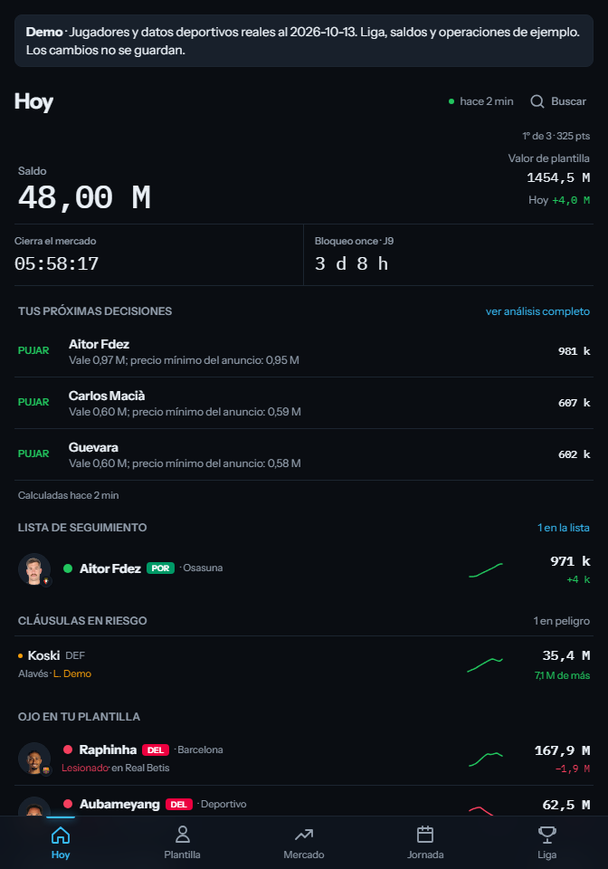
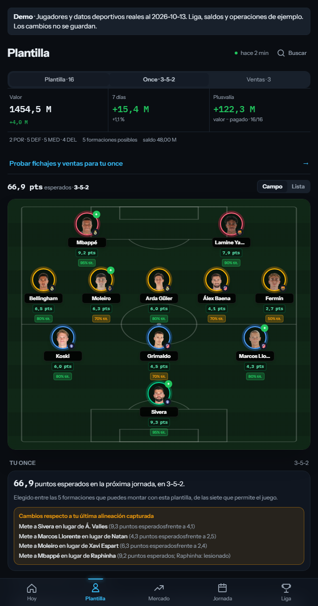
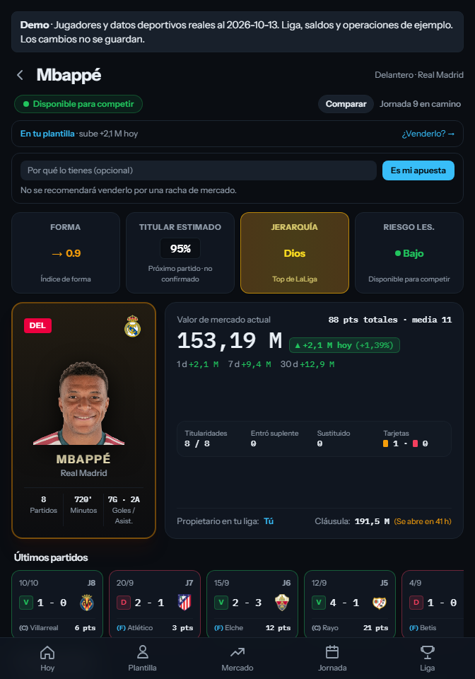
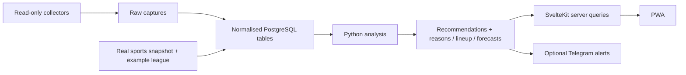

# LFM · explainable fantasy football analytics

[](https://github.com/Braisdlim/lfm-fantasy/actions/workflows/ci.yml)
[Español](README.es.md) · [Review in 5 minutes](docs/review.md) · [Run locally](docs/setup.md) · [Architecture](docs/architecture.md)

**A personal full-stack project that turns football data into decisions you can inspect.**

LFM answers three practical questions: which player is worth buying, how much is sensible to bid, and which legal eleven gives my squad the highest estimated points next gameweek. It combines a Python data pipeline, PostgreSQL and a mobile-first SvelteKit PWA. Decisions come from code; every recommendation carries numerical reasons and its assumptions.

This is a curated public edition of an application used privately. The demo uses **real players, clubs, prices, points and fixtures**, captured on **13 October 2026**, in an explicitly labelled **example fantasy league**. Its managers, balances, transfers and asking prices are illustrative. No production database, account or credentials are needed.

**For a technical review:** [follow seven claims into their code and tests](docs/review.md), read the [architecture trade-offs](docs/decisions.md), or inspect the [database optimisation case study](docs/engineering.md). The interface is in Spanish; the technical documentation is in English.



## Try it locally

Install Docker with Compose, then:

```bash
git clone https://github.com/Braisdlim/lfm-fantasy.git
cd lfm-fantasy
docker compose up --build
```

Open **http://localhost:5173**. The first start builds the images, creates a dedicated PostgreSQL 17 database and loads a bounded real snapshot: **64 players, 20 clubs, 5,107 price observations, 486 gameweek point records and 130 fixtures**. Three example fantasy teams use those players. The actual backend computes forecasts, recommendations and the suggested lineup. Explore all screens and simulate transfers; persistence actions are disabled in the demo.

Sport dates and missing observations are preserved. Restarting does not invent newer prices; source freshness can expire. Rebuilding the example league does not refresh the bundled sports snapshot. See [data provenance](docs/publication.md) and [resetting the local demo](docs/setup.md#refresh-the-demo). It makes no LaLiga, FútbolFantasy or Telegram requests; player photos and badges reference their original public asset URLs.

## What you can explore

| Screen | What it demonstrates |
| --- | --- |
| Today | Prioritised recommendations, bid ceilings, cash constraints and explicit uncertainty |
| Squad & suggested eleven | Seven legal formations, availability checks and changes from the captured lineup |
| Market & player detail | Comparable price histories, ownership, clauses and points |
| Transfer planner | Several buys/sales in one scenario, resulting cash and the best legal eleven |
| Gameweek | Poisson match forecasts, opponent difficulty and future fixtures |
| League, watchlist & journal | Rival estimates, personal thresholds and retrospective decision tracking |

<table>
  <tr>
    <td></td>
    <td></td>
  </tr>
  <tr>
    <td>Suggested lineup · computed by Python</td>
    <td>Player detail · history and provenance</td>
  </tr>
</table>

[More screenshots and a guided walkthrough →](docs/walkthrough.md)

## How it works



The pipeline keeps raw responses before normalisation so parser changes can be investigated. Collection and analysis commit separately: a failed model must not discard a captured market snapshot. The PWA reads prepared results; it does not call the game API or train models during navigation.

**Buying:** compare an empirical winning-bid reference with a profitability ceiling, constrained by cash and squad fit. The winning-bid percentile is a description of observed winning bids, **not** a calibrated probability of winning a future auction.

**Lineup:** estimate player points for the next unlocked gameweek, exclude unavailable players, and evaluate the seven permitted formations. Missing probabilities remain distinguishable from known zeroes. See [the model contract](docs/criterio.md).

## Engineering decisions worth reading

- **Explainability:** persisted `reasons[]`, source labels, sample sizes, assumptions and decision logs. An LLM is not needed to make recommendations.
- **Resilience:** isolated analysis steps, retries/backoff, collection deduplication, source freshness and operational run summaries.
- **Efficient database reads:** batched SQL, scoped histories, a verified persistent price-model cache, coalesced web reads and a quota circuit breaker.
- **Measured optimisation:** journal calculation reduced from 436 queries to 6 on one production sample with equal output. A refreshed suggested eleven read roughly 55 KB of SQL results in another sample. These are case-study observations, not universal performance promises.
- **Verification:** Python unit/contract tests, PostgreSQL integration tests, TypeScript tests, Svelte diagnostics, production build and a Compose demo smoke test.
- **Data boundaries:** the public snapshot has a fresh Git history; private runbooks, credentials, account IDs and raw production captures are excluded. Only allowlisted public sporting fields enter the sample. The local demo refuses an unrelated database name/role and an existing non-demo database.

[Read the optimisation case study →](docs/engineering.md)

## Stack & repository map

| Layer | Tools | Location |
| --- | --- | --- |
| Collection & analysis | Python 3.12+, HTTPX, Pydantic, SQLAlchemy Core, psycopg, selectolax | `src/lfm/` |
| Storage | PostgreSQL 17; Neon HTTP in private serverless deployment | `src/lfm/db/` |
| Web | SvelteKit 2, Svelte 5, TypeScript, Tailwind 4, ECharts | `web/` |
| Automation | GitHub Actions; optional Cloudflare scheduler | `.github/`, `trigger/` |
| Quality | pytest, Ruff, Node test runner, Playwright demo smoke | `tests/`, `web/tests/` |

```text
src/lfm/
  api/          authentication, endpoint map and HTTP client
  collectors/   response → raw capture → normalised tables
  sources/      external HTML adapters and name matching
  analysis/     bidding, points, lineup, cash, forecasts and journal
  db/           schema, batched reads, verified caches and backups
  jobs/         daily/light orchestration and budget guards
  notify/       optional Telegram delivery
  demo.py       isolated real-snapshot / example-league seed
web/            PWA, server queries, planner and charts
docs/           architecture, setup, operations and screenshots
```

## Testing

```bash
uv sync --locked
uv run ruff check .
uv run ruff format --check .
uv run pytest -q
cd web
npm ci
npm test
npm run check
npm run build
```

PostgreSQL-dependent tests run in CI with a disposable service; set `TEST_POSTGRES_URL` locally to run them. **Never point integration tests at production.** On Windows, use `npm.cmd` when PowerShell blocks npm, and `npm run build:local` if the Vercel adapter cannot create symlinks.

Each CI run publishes Python test results and an HTML branch-coverage report. [Verification details](docs/review.md#what-the-checks-establish) explain what the checks establish and their limits. CodeQL analyses Python and JavaScript/TypeScript; dependency alerts and secret push protection are enabled.

## Scope and honest limitations

This is a **single-owner application**, not a production multi-tenant SaaS. Sharing its password shares the same workspace. Independent users currently need isolated deployments; a shared service needs tenant-aware queries, authorisation and model/cache boundaries. [Adding users](docs/users.md) explains both paths.

Game API access is unofficial and can change. Forecasts are estimates; missing coverage, delayed sources and uncertain rival balances are visible constraints. The demo proves reproducibility and integration, **not predictive accuracy**. Production-specific learned constants remain documented assumptions, not transferable guarantees. Automated jobs never buy, sell or change the game lineup.

The deployed personal instance remains private. This public repository contains no scheduled production collection or production backup artifacts. It is publicly viewable but has no open-source licence grant. Third-party libraries retain their licences; no licence is granted here to third-party sports content or trademarks. See [publication scope](docs/publication.md), [ownership and AI assistance](docs/review.md#ownership-and-scope), and [deployment](docs/deployment.md).
