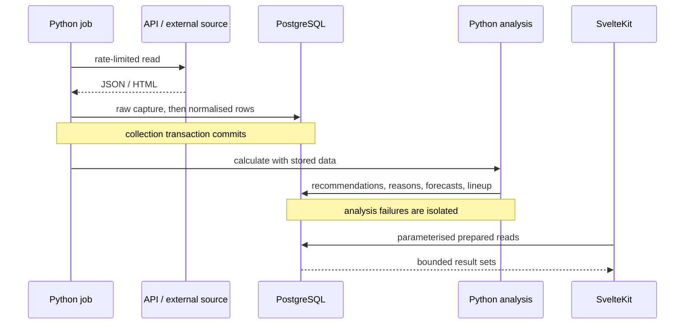

# Architecture

## Boundaries

LFM is a scheduled data pipeline plus a server-rendered PWA. Python owns ingestion and recommendation logic. PostgreSQL stores both source evidence and prepared outputs. SvelteKit owns presentation and a client-side what-if planner; it does not collect game data.

## Modules and data

| Responsibility | Entry points | Main tables |
| --- | --- | --- |
| HTTP/auth | `api/client.py`, `api/auth.py` | `auth_tokens` in a private instance |
| Raw provenance | `db/session.py`, `db/raw_payload.py` | `raw_snapshots`, `raw_html_blobs` |
| Official collection | `collectors/players.py`, `league.py`, `calendar.py`, `value_history.py` | `players`, `teams`, price/point series, squad, market, activity, matches |
| External adapters | `sources/futbolfantasy.py`, `lineups.py` | aliases, availability, set pieces, season stats |
| Price estimation | `analysis/price_models.py`, `drift.py`, `rebound.py`, `trend.py` | verified `analysis_cache` and price series |
| Sporting decisions | `points.py`, `fixtures.py`, `eleven.py` | `match_forecast`, `lineup_daily` |
| Decision layer | `recommend.py`, `bids.py`, `watchlist.py` | `recommendations`, `recommendation_log`, `watchlist` |
| Retrospective views | `cash.py`, `rivals.py`, `journal.py` | cash estimates, rival radar, decision journal |
| Read layer | `web/src/lib/server/queries.ts`, `db.ts` | cached SQL results; no model training |

The canonical schema is [schema.sql](../src/lfm/db/schema.sql). Changes are appended and applied by `python -m lfm.db.migrate`. This migration history includes data updates: always back up a private deployment first.

## Two rhythms

`jobs/daily.py` collects the broader catalogue, squads, activity and calendar, updates sources, runs analysis and optionally sends a summary. `jobs/light.py` refreshes market/own squad/activity and recomputes decisions and lineup; expensive external availability is refreshed only when due. A recent-run guard deduplicates overlapping attempts.

The public CI runs tests and the snapshot demo. Live collectors are an explicit, private deployment choice, not something a visitor's clone starts automatically.

## Why prepared outputs?

Training on every request would couple a page load to the size of historical data and repeat costs in serverless workers. Persisting model outputs makes model behaviour testable independently from rendering. It also separates “a fresh market was captured” from “a recommendation calculation succeeded”.

The web has a short per-process cache that coalesces identical concurrent queries. It is not a globally shared cache; cold functions can still read PostgreSQL. Its quota circuit breaker avoids repeatedly hitting a known suspended database, and invalidation prevents stale in-flight responses from replacing newer data.

## Time and missing data

Market cycles use their actual closing timestamp, not calendar midnight. Values are compared with the exact previous date from the same source. Missing data stays `NULL`. Future opponent difficulty is not future injury knowledge. The active lineup horizon is one next unlocked gameweek, not all fixtures currently stored.

## Demo

`demo.py` imports an allowlist of real public sport tables from `demo_data.json`, creates a fictional league and invokes the actual analysis modules. Dates, nulls and source timestamps are preserved. The Compose web uses a small PostgreSQL transport (`pg`) with the same queries; a private Neon deployment uses HTTP. The seed requires a database/role named `lfm_demo`, refuses a nonempty unmarked database, commits transactionally and marks completed seeds. A repeated start preserves the existing example league.

The sample selects high-point players and strong points/value players within each position. Its 64-player population and illustrative auction history differ from the private full catalogue; model results are demo decisions, not a replay of private recommendations. Public price/stat inputs are real, while league transactions are clearly marked as examples.

The demo does not contain a production dump. All write HTTP methods are rejected by the server hook in demo mode. The planner remains usable because its scenarios are calculated in the browser without persisting game actions.
