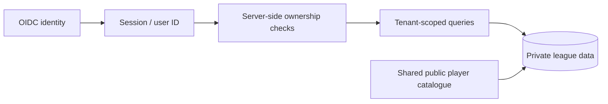

# Adding users without mixing their data

## What exists now

There is no registration endpoint, user table, account management or tenant isolation. `APP_PASSWORD` protects one workspace using an HTTP-only cookie, signed with a separate `AUTH_SECRET` and validated for expiration on the server. The own team is selected from `league_teams.is_me`; watchlists/theses and several queries are global to that database. An extra password does not create an independent user.

The portfolio demo binds only to the local machine, uses real public sporting data in an example league and rejects persistence actions. It is not access to the private live instance.

## Supported today: one isolated instance per owner

1. Create a separate **private** deployment repository.
2. Provision a separate PostgreSQL database and separate game credentials.
3. Apply the schema and configure that owner's `LEAGUE_ID`.
4. Run collection and verify exactly one own team (`is_me`) in that database.
5. Deploy a separate web project using that database, a distinct `APP_PASSWORD` and an independent `AUTH_SECRET`.
6. Keep that instance's refresh token, notifications, caches and backups separate.

This supports several people with infrastructure isolation and no cross-user data leakage from global queries. It duplicates collection/storage and has operational overhead. A shared workspace can deliberately share one password, but everyone then sees and edits the same data; it is not independent accounts.

## Proposed shared-service design — not implemented

Before turning this into a shared service:

- Introduce `users`, `memberships`, tenant/league ownership and per-user private game connections.
- Add owner/tenant keys to watchlists, theses, decision logs and all private records. Catalogue data can be shared where its source and rights allow it.
- Replace global `is_me` and “latest day” selection with a validated user/league scope. Audit every query; filtering only the UI is insufficient.
- Replace the shared password with an identity provider and scoped server sessions; add logout, idle-session expiry, abuse controls and individual session revocation. Current sessions have a 30-day absolute expiry and global revocation by signing-key rotation.
- Scope caches, background jobs, Telegram destinations and model fingerprints. Authorise mutations on the server, including object ownership checks.
- Define secrets encryption/rotation, access logs, deletion and backup boundaries.
- Add two-tenant integration tests that attempt cross-user reads and writes, including forged IDs and cache collisions.

Completion criteria: two owners can use the same app and database while neither can read, mutate or trigger collection for the other, and public data is collected once where appropriate. This is a separate engineering milestone rather than a checkbox in configuration.
