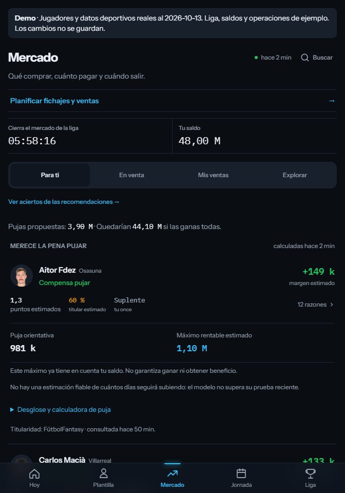
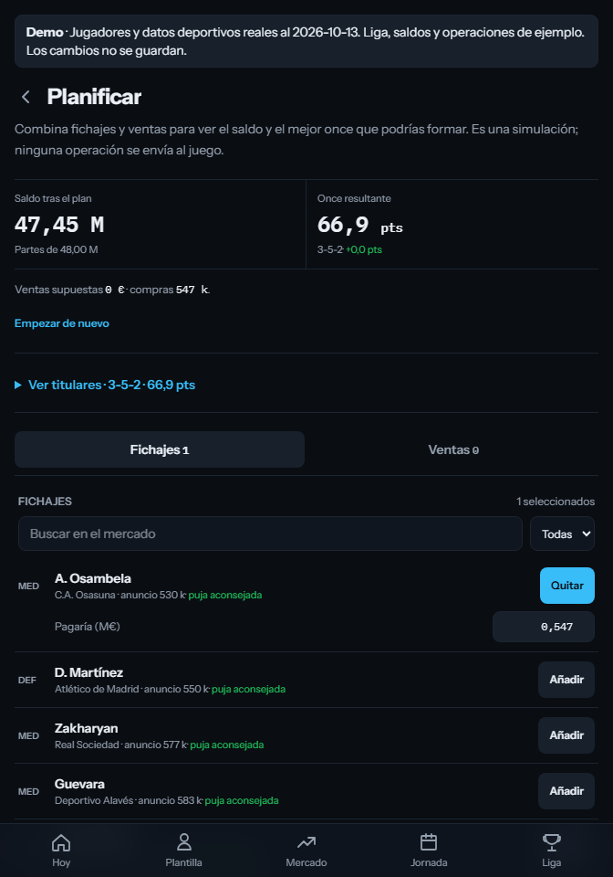
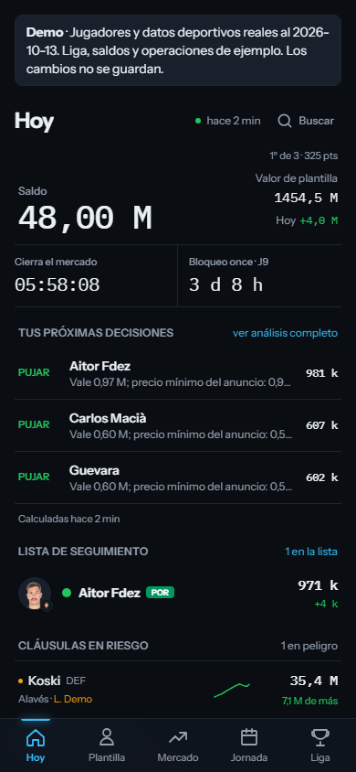

# Inside the app

These screenshots are captured from the running Compose demo, not mockups. Players, clubs, market values, point histories and fixtures are real observations dated 13 October 2026. Managers, balances and trades belong to an explicitly labelled example league. The seed feeds the same Python analysis and SQL read layer as the private application.

## Today: decide what matters

Cash, market close, next lineup lock and prioritised actions share one screen. The purchase recommendation is bounded by its individual ceiling and available budget. Following the market link opens the detailed bid explanation.


## Market: inspect the recommendation

The market connects the current asking price, historical winning-bid reference, profitability ceiling and expected marginal squad benefit. Unknowns and assumptions are part of the explanation. Players can remain `no_pujar` or `sin_datos`; showing a positive-looking chart does not force a buy.



## Squad: highest estimated points among legal lineups

Python compares the seven permitted formations using own players and current availability for the next unlocked gameweek. The view distinguishes suggested starters, the captured actual lineup and players excluded due to injury. It does not submit changes to the game.


## Player: inspect history

A player's value history, recent changes, estimated availability and point totals explain the inputs behind decisions. Source-specific date comparisons prevent “yesterday” being substituted by an arbitrary older observation.


## Planner: combine operations

Select several buys and sales, edit assumed amounts, then compare the resulting cash and best lineup. An unaffordable purchase, sale that breaks the lineup or an unknown points estimate is shown explicitly. A temporary scenario is not a completed trade.



## Mobile

The same application is designed for a phone-sized viewport, with a bottom navigation bar and compact decision rows.



## Reproduce the captures

Start the demo, then from `web/`:

```bash
npm ci
npx playwright install chromium
CAPTURE_SCREENSHOTS=1 npm run demo:smoke
```

In PowerShell:

```powershell
$env:CAPTURE_SCREENSHOTS = '1'
npm.cmd run demo:smoke
```

The script checks route responses, search, a planner interaction, rejection of a write request, mobile overflow and browser runtime errors. Screenshots come from that run and can differ in relative dates after regenerating the seed. CI verifies the behaviour without committing new screenshots on every run.
